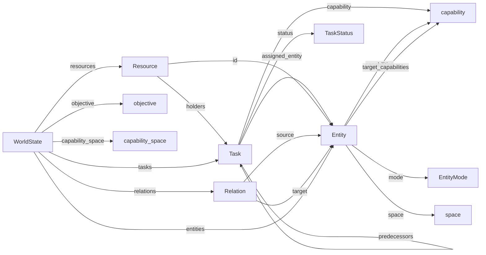

# 11. 공통 언어 v0 — 엔진의 개념(부품)과 관계

> **생성 문서 — 직접 고치지 않는다.** `uv run python -m asel.vocabulary` 로 `src/asel/vocabulary.py` 에서 만든다.
> 코드와 어긋나면 `tests/test_vocabulary.py` 가 실패한다. 상태: v0 (환경 A 물류에서 실제로 쓰는 개념만, 2026-11-11).
> 범용 온톨로지는 장기 후보(R-15). 새 개념은 새 산업 환경에 **실제로 필요할 때만** 추가하고 변경 이력을 남긴다.

## 개념 관계도

## 부품 목록

### Entity

셀·설비·작업장 같은 '일을 하는 곳'. 산업별 의미는 type 과 capabilities 로만 표현한다

- 필드/값: `id`, `type`, `capabilities`, `properties`, `reconfig`, `space`, `mode`, `target_capabilities`, `mode_since`

### Resource

용량이 있는 자원. 동시에 처리할 수 있는 작업 수(capacity), 예약(holders), 고장 단위(out_of_service)

- 필드/값: `id`, `capacity`, `holders`, `out_of_service`

### Task

처리해야 할 일 한 단위. 필요한 역할(capability), 선행 작업(predecessors), 생명주기(status)

- 필드/값: `id`, `capability`, `duration`, `predecessors`, `status`, `created_index`, `created_at`, `ready_at`, `started_at`, `completed_at`, `assigned_entity`, `tags`

### Relation

개체 사이의 연결 (예: 물자 흐름). v0 에서는 기록만 하고 흐름 제약으로 쓰지 않는다

- 필드/값: `source`, `target`, `kind`

### WorldState

세계의 현재 상태. version(모든 변경), structure_version(구조 변경), 시각

- 필드/값: `version`, `structure_version`, `objective`, `capability_space`, `sim_time`, `entities`, `relations`, `resources`, `tasks`

### TaskStatus

작업 생명주기: CREATED → WAITING → READY → RUNNING → COMPLETED (예외: BLOCKED/FAILED/CANCELLED)

- 필드/값: `CREATED`, `WAITING`, `READY`, `RUNNING`, `COMPLETED`, `BLOCKED`, `FAILED`, `CANCELLED`

### EntityMode

개체의 재구성 상태: normal / draining(새 작업 중단) / changeover(역할 전환 중)

- 필드/값: `normal`, `draining`, `changeover`

### capability (값)

어떤 일을 할 수 있는지 나타내는 라벨 (예: pick, pack). Task 가 요구하고 Entity 가 제공한다

### objective (값)

현재 운영 목표 {id, kind, params}. 공개 정보 — 채점식은 평가기 전용 (R-07 미결정, #38)

### space (값)

정적 3D 배치 {x, y, width, depth, ceiling_m} — 바닥 점유와 천장 높이 (#40, 결정 0007)

### capability_space (값)

역할별 공간 요구 {capability: {height_m}}. 천장보다 높은 역할로는 전환할 수 없다

## 관계

| 출발 | 필드 | 도착 | 의미 |
|---|---|---|---|
| Task | `predecessors` | Task | 먼저 끝나야 하는 작업 (여러 개 가능 = 갈라짐·합침 흐름) |
| Task | `assigned_entity` | Entity | 작업이 실행되는 곳 |
| Task | `capability` | capability | 작업이 요구하는 역할 |
| Task | `status` | TaskStatus | 작업 상태 |
| Entity | `capabilities` | capability | 개체가 제공하는 역할 |
| Entity | `target_capabilities` | capability | 재구성 후 제공할 역할 |
| Entity | `mode` | EntityMode | 재구성 상태 |
| Resource | `id` | Entity | 자원은 같은 id 의 개체에 속한다 (v0: 개체당 자원 1개) |
| Resource | `holders` | Task | 자원을 예약 중인(실행 중인) 작업 |
| Relation | `source` | Entity | 연결의 출발 |
| Relation | `target` | Entity | 연결의 도착 |
| WorldState | `entities` | Entity | 세계에 있는 개체 |
| WorldState | `resources` | Resource | 세계에 있는 자원 |
| WorldState | `tasks` | Task | 세계에 있는 작업 |
| WorldState | `relations` | Relation | 세계에 있는 연결 |
| WorldState | `objective` | objective | 현재 운영 목표 |
| Entity | `space` | space | 개체의 3D 배치 |
| WorldState | `capability_space` | capability_space | 역할별 공간 요구 |

## 행동 (부품을 움직이는 동사)

| 행동 | 의미 |
|---|---|
| `begin_outage` | 고장 시작: 자원 용량 일부 사용 불가 (환경). 원인은 비공개 |
| `cancel_tasks` | 아직 시작하지 않은 작업 포기 (환경, 예: 요청 시간 초과). 진행 중 작업은 끝까지 |
| `complete_reconfiguration` | 역할 전환 완료 (환경) |
| `complete_task` | 작업 완료 = 자원 해제 + 후속 작업 READY (환경) |
| `create_task` | 작업 생성 (환경). 실제 처리 시간은 비공개 |
| `end_outage` | 고장 종료 (환경) |
| `request_reconfiguration` | 역할 전환 요청 (구조 제어 주체) |
| `set_objective` | 운영 목표 변경 (환경) |
| `start_task` | 작업 시작 = 자원 예약 + RUNNING (배정 주체) |

## 사건 (기록되는 사실)

| 사건 | 의미 |
|---|---|
| `ActionProposed` | 행동 제안 기록 |
| `ActionRejected` | 행동 거절과 사유 (사유는 공개되므로 숨겨진 값을 넣지 않는다) |
| `ObjectiveChanged` | 운영 목표 변경 (공개) |
| `ReconfigurationCompleted` | 새 역할 적용 |
| `ReconfigurationRequested` | 재구성 요청 (작업 비우기 시작) |
| `ReconfigurationStarted` | 역할 전환 시작 |
| `ResourceOutageEnded` | 고장 종료 |
| `ResourceOutageStarted` | 고장 시작 (공개: 단위 수) |
| `ResourceReleased` | 자원 해제 |
| `ResourceReserved` | 자원 예약 |
| `RunEnded` | 실행 종료 |
| `TaskCreated` | 작업 생성 |
| `TaskStateChanged` | 작업 상태 전이 |
| `WorldInitialized` | 세계 초기화 (개체·연결·자원) |

## 산업 단어는 어디에 있나

코어에는 산업 단어가 없다. `pick`, `pack`, `order` 같은 말은 시나리오 파일과 도메인 어댑터에만 있다.
새 산업은 (1) 시나리오에서 개체 type·capability 라벨을 정하고 (2) 작업 흐름을 정의해서 이식한다.
